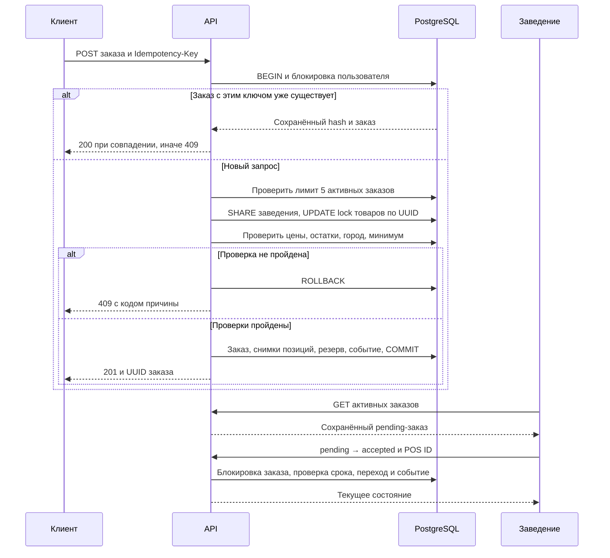
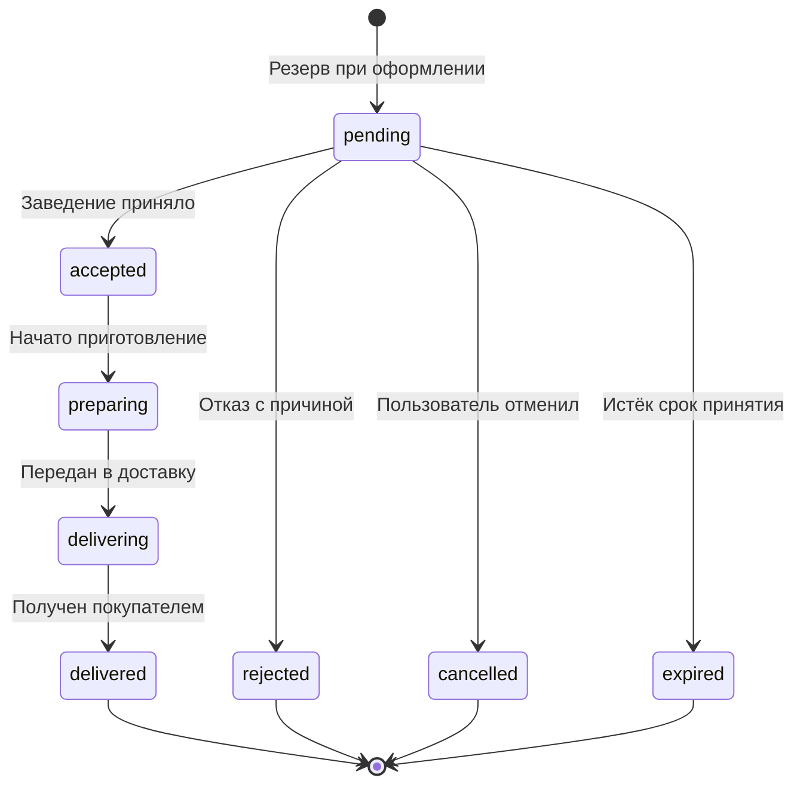

# Архитектурные решения

C4 Level 2 находится в README. Здесь описаны внутренние границы и поведение при сбоях.

## Модули и ответственность

| Модуль | Ответственность |
| --- | --- |
| `cmd/api` | Конфигурация, запуск и корректная остановка HTTP-сервера, обработчик истечения заказов, CLI миграции и регистрации |
| `internal/httpapi` | HTTP-маршруты, ограничения JSON/частоты/конкурентности, заголовки, ключи заведения и шлюза, перевод ошибок в HTTP |
| `internal/domain` | Модели, нормализация, проверки входных данных, допустимые переходы |
| `internal/store` | SQL и бизнес-операции, которым нужна одна транзакция: резерв, оформление, отмена, переход, приход |
| `migrations` | Встроенные up/down SQL, последовательное применение, версии и контрольные суммы |
| `cmd/restaurant` | Независимые HTTP DTO и клиент; демонстрация меню и обработки заказов |

## Конкурентное оформление

- Изоляция — PostgreSQL Read Committed с явными блокировками строк. Остатки и заказ меняются в одной транзакции. Даже если последняя проверяемая позиция корзины недоступна, частичного списания нет.
- Все товары блокируются в порядке UUID. Возврат резерва использует тот же порядок, чтобы пересекающиеся корзины не создавали циклических ожиданий.
- `FOR SHARE` на заведении согласует оформление с его закрытием оператором/партнёром. Новые заказы одного заведения не сериализуются этой блокировкой, пока нет изменения карточки.
- Advisory transaction lock сериализует все оформления одного пользователя, включая разные ключи. После проверки повтора транзакция считает активные заказы; максимум 5 действует во всех заведениях и на всех API-репликах. Отказ не резервирует товар и не занимает ключ. `UNIQUE(user_id, idempotency_key)` остаётся постоянным ограничением в БД. Коллизия хеша блокировки может лишь добавить ожидание; содержимое запроса сравнивается полным SHA-256.
- Цена, название и внешний ID блюда копируются в `order_items`. Последующее редактирование меню не переписывает историю заказа. Все вычисления суммы целочисленные.
- Отмена, принятие, отказ и истечение сначала блокируют строку заказа. Состояние проверяется под блокировкой. Возврат возможен только при уходе из `pending` в отменённое/отклонённое/истёкшее состояние; повтор события его не повторяет.
- Фоновый обработчик выбирает одну просроченную строку с `FOR UPDATE SKIP LOCKED`, освобождает резерв и фиксирует событие. Несколько экземпляров API могут безопасно выполнять эту работу одновременно.
- Чтение заказа формирует заголовок, позиции и историю одной SQL-командой, поэтому ответ соответствует одному MVCC snapshot.

## Машина состояний

`expires_at` — срок только для принятия. Переход `accepted → preparing` через час технически допустим: контроль SLA принятых заказов — отдельное будущее требование.

## Повторы и восстановление

| Сбой | Поведение |
| --- | --- |
| Ответ на оформление потерялся после COMMIT | Повтор с тем же ключом возвращает существующий заказ и его текущий статус |
| Процесс API остановился до COMMIT | PostgreSQL откатывает транзакцию; запрос можно повторить |
| Ответ на приход остатка потерялся | Повтор ID события с тем же payload ничего не добавляет |
| POS перезапущен | Повтор bootstrap-событий безопасен, затем чтение активных заказов |
| Ответ на переход потерялся | Непосредственный повтор того же перехода возвращает 200; если заказ ушёл дальше — 409 и перечитывание |
| Два процесса POS читают заказ | Проверка `from_status` и блокировка строки исключают повторные события; внешний побочный эффект реального POS тоже должен быть идемпотентным по UUID заказа |
| Заведение не отвечает до дедлайна | Worker освобождает резерв и устанавливает expired |
| API недоступен | Демосервис повторяет запросы раз в секунду; после восстановления продолжает. Он не считает неуспешный вызов выполненным |
| Ошибка отдельного заказа | Остальные заказы партии обрабатываются; keyset-курсор позволяет дойти до следующих страниц, а проблемный заказ повторяется в новом проходе. Ошибки соединения, 401/403/429 прекращают проход |

Демосервис обходит активную очередь страницами по 100 заказов. Курсор опирается на `(created_at, id)` и читает якорь без фильтра по статусу, поэтому завершённый при обработке заказ не сдвигает следующую страницу. Короткая страница завершает проход, после чего он начинается заново и повторяет проблемные заказы. При росте нагрузки понадобятся задержка между повторными попытками, карантин проблемных заказов, алерты и метрики возраста очереди.

## Безопасность

Запросы покупателей к заказам проходят через доверенный шлюз. Он проверяет сессию пользователя и передаёт `X-User-ID` вместе с закрытым `X-Gateway-Key`.

Заведения используют отдельные API-ключи и имеют доступ только к своим меню, остаткам и заказам.

API подключается к PostgreSQL через ограниченную роль `kitchen_app`. Миграции и регистрация заведений выполняются отдельно с правами оператора.

Сервис ограничивает частоту и количество одновременно обрабатываемых запросов. При превышении лимита возвращается HTTP 429.
