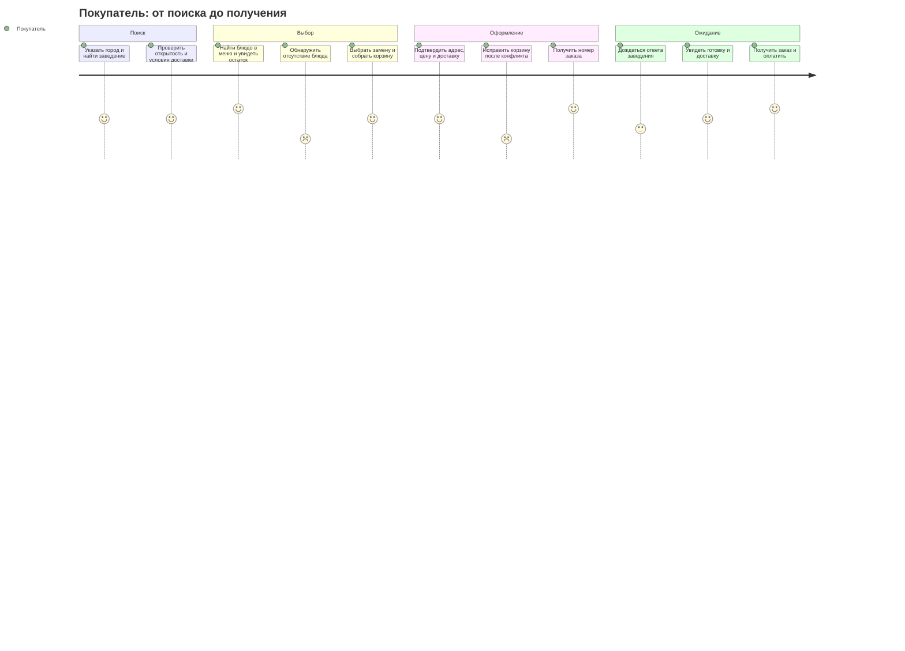
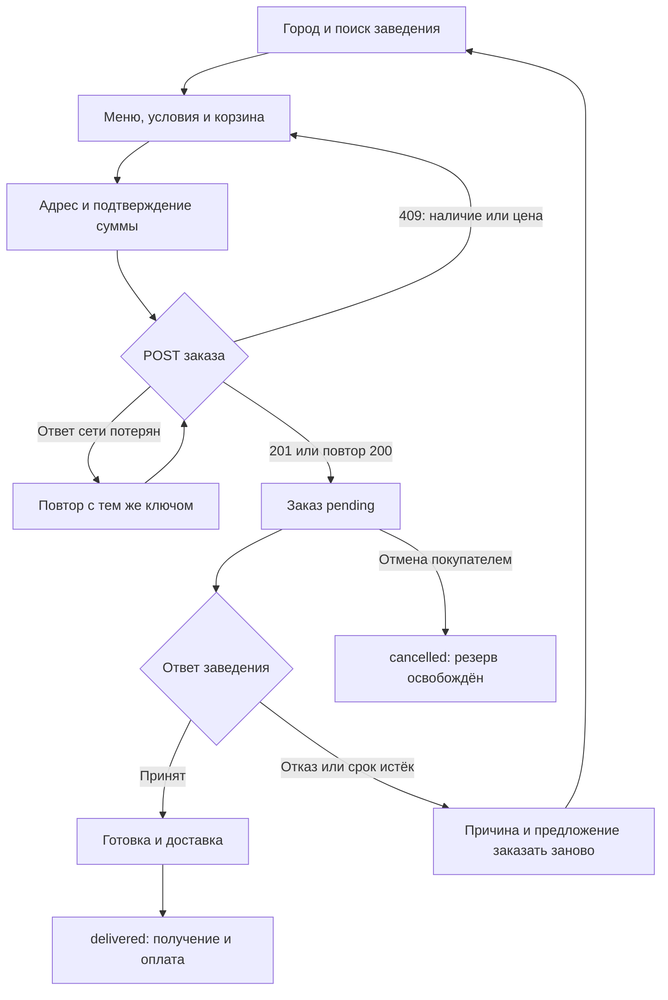
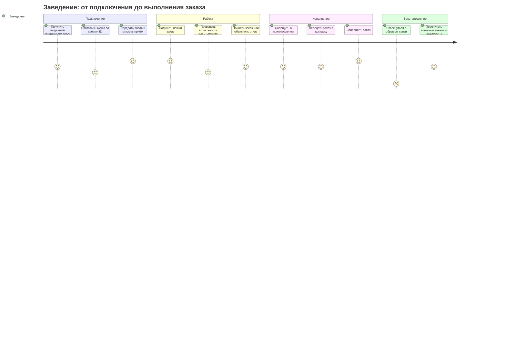
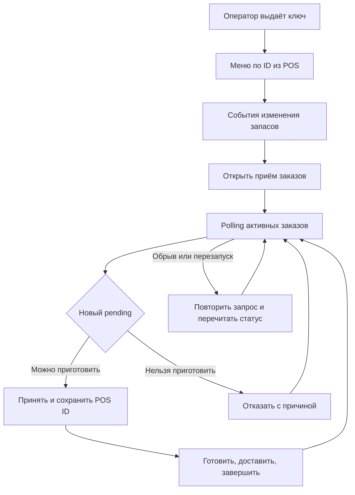

# Пользовательские сценарии

## Покупатель

| Этап и цель | Действие клиента | Трудность | Реакция API и интерфейса |
| --- | --- | --- | --- |
| Найти доступное заведение | Ввести город, название или тип кухни | Заведение закрыто; в городе нет результатов | Каталог включает `is_open`, условия и суммы; UI объясняет отсутствие результатов |
| Выбрать блюдо | Открыть меню, фильтровать категорию или искать название | Нулевой остаток | Позиция видна с `available_stock=0`; UI отключает добавление |
| Собрать корзину | Выбрать количество блюд одного заведения | Минимальная сумма не достигнута | UI показывает недостающую сумму; сервер повторно проверяет и возвращает `minimum_order` |
| Подтвердить заказ | Передать адрес, город и ожидаемые цены | Товар купили одновременно; цена изменилась; заведение закрылось | Атомарный отказ 409 без заказа и списаний; обновить меню, предложить замену, запросить подтверждение цены |
| Оформить ещё один заказ | Подтвердить новую корзину | Уже есть 5 активных заказов | `409 active_order_limit`; дождаться завершения или отменить ожидающий заказ. Повтор прежнего оформления разрешён |
| Получить результат | Сохранить номер заказа | После POST потерялся ответ сети | Повторить тот же payload с тем же ключом; получить существующий заказ |
| Передумать | Нажать отмену до принятия | Заведение одновременно принимает заказ | Одна команда побеждает под блокировкой; UI перечитывает заказ при 409 |
| Дождаться заведения | Polling `GET /orders/{id}` | Заведение отказывается или не отвечает | Статус `rejected` с причиной либо `expired`; остатки возвращены, UI предлагает другой заказ |
| Получить еду | Следить за этапами готовки и доставки | Интеграция временно отключилась | Отображается последнее сохранённое состояние; после восстановления этапы продолжаются |

## Заведение

| Этап и цель | Контракт | Трудность и решение |
| --- | --- | --- |
| Закрытое подключение | Оператор: `api provision` | Только предварительно допущенные заведения получают ключ; самостоятельной регистрации нет |
| Синхронизация меню | `PUT /partner/menu/items/{external_id}` | POS не знает UUID площадки: передаёт собственный ID, уникальный в пределах заведения |
| Загрузка остатка | `POST /partner/inventory-adjustments` | При повторе события после сбоя нельзя удвоить запас: стабильный `external_id` события |
| Открытие/закрытие | `PATCH /partner/restaurant` | При перегрузке закрыть новые заказы; существующие продолжить выполнять |
| Получение заказа | Polling `GET /partner/orders?status=active` | Не нужен публичный адрес POS; заказ остаётся в БД и виден после перезапуска |
| Принятие | `pending → accepted` с `external_order_id` | POS создаёт локальную связь идемпотентно по UUID заказа; повтор перехода безопасен в том же состоянии |
| Отказ | `pending → rejected`, обязательный `reason` | Фактическая кухня может обнаружить проблему, неизвестную учёту запасов; объяснить причину, освободить резерв |
| Исполнение | `accepted → preparing → delivering → delivered` | Недопустимый скачок или устаревшее состояние: 400/409, перечитать заказ |
| Восстановление | Повторить синхронизацию, затем polling | В демо ID первоначального прихода и POS-заказа детерминированы; перезапуск не сбрасывает остаток и не теряет этап |

