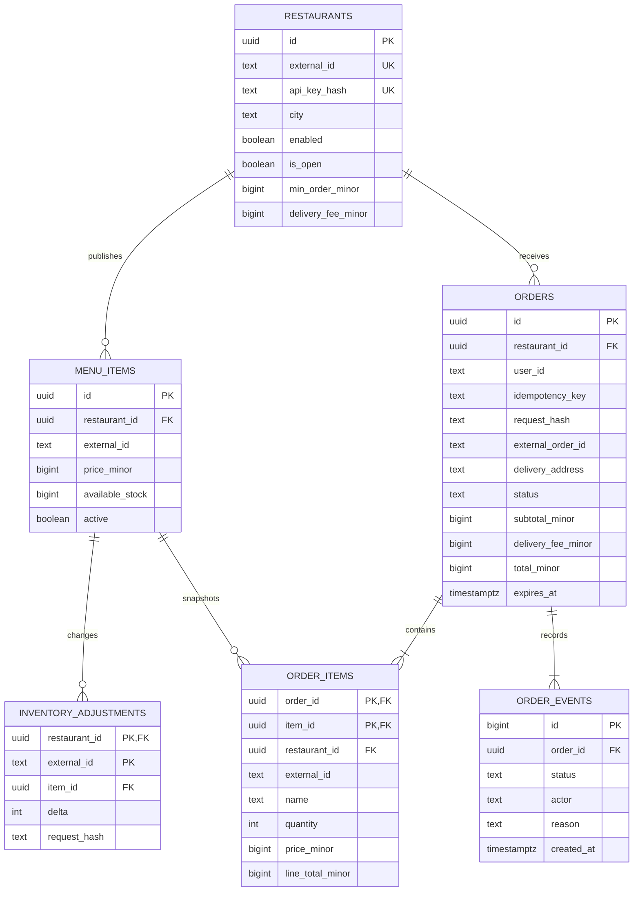

# Схема данных

Источник истины схемы — миграции `001_init.up.sql` и `002_order_indexes.up.sql`. Внутренние ID — UUID, выдаваемые PostgreSQL через `gen_random_uuid()`. Время хранится в `timestamptz`; валюта фиксирована RUB, денежные суммы — `bigint` в копейках.

## Связь с внешними системами

| Данные | Внутренний ключ | Внешний ключ и область уникальности |
| --- | --- | --- |
| Заведение | `restaurants.id` | `restaurants.external_id`, уникален для площадки; задаётся оператором |
| Товар POS | `menu_items.id` | `(restaurant_id, external_id)`; два заведения могут иметь товар `pizza-1` |
| Пользователь | Нет локальной сущности аккаунта | `orders.user_id` — непрозрачный ID основной площадки из `X-User-ID`, который устанавливает шлюз с `X-Gateway-Key` |
| Заказ | `orders.id` | `(restaurant_id, external_order_id)` после принятия; до этого NULL |
| Запрос оформления | Заказ | `(user_id, idempotency_key)` и хеш нормализованного тела запроса |
| Приход/коррекция остатка | Составной PK | `(restaurant_id, external_id)` события; хеш предотвращает переиспользование ID с другой дельтой |

В заказе сохранены снимки города/адреса, стоимости доставки, имени/цены/внешнего ID каждого блюда. Меню не удаляется через API: скрытие выполняется `active=false`, сохраняя ссылки исторических заказов. Внешний ID товара изменять нельзя; новый ID — новая карточка.

## Ограничения и индексы

- CHECK не позволяет отрицательный доступный остаток, отрицательные суммы, недопустимые количество, цену и статус. Для accepted и следующих состояний необходим внешний ID заказа.
- Составные внешние ключи из `order_items` на `(id, restaurant_id)` заказа и товара запрещают связать строку заказа с товаром другого заведения даже через прямую запись в БД.
- `orders.total_minor` и `order_items.line_total_minor` — generated columns. Сумму позиций для `subtotal_minor` проверяет транзакционный код. Межстрочная сумма не выражается простым CHECK; триггер для неё в MVP не введён.
- История `order_events` добавляется в той же транзакции, что и статус. Идентификатор события обеспечивает однозначный порядок при одинаковом времени.
- Индекс `(user_id, created_at, id)` обслуживает историю пользователя. Частичный индекс активных заказов заведения — polling. Частичный индекс `expires_at WHERE status='pending'` — worker. Миграция 2 добавляет частичный индекс `user_id` для лимита активных заказов и полный `(restaurant_id, created_at, id)` для истории заведения. UUID в запросах не приводится к тексту.
- `lower(city)` индексирован для каталога. Для поиска подстроки пока нет отдельного индекса. Фильтр по завершённым заказам заведения оптимизируется позже по нагрузке.

## Остатки

`available_stock` — количество, которое ещё можно заказать на площадке. При оформлении из него вычитается резерв; при отказе/отмене/истечении он возвращается. Приходы POS увеличивают доступный запас отдельными идемпотентными событиями. Повторная публикация карточки остаток не меняет.

Резервы представлены pending-заказами и их строками; отдельная таблица резервов для MVP не нужна. Общий физический запас заведения, другие каналы продаж, рецепт и ингредиенты не моделируются. Поэтому интеграция требует заранее выделенного площадке запаса или корректных дельт от POS. При отрицательной корректировке нельзя забрать уже зарезервированные позиции.

## Миграции

`schema_migrations(version, checksum, applied_at)` — служебная таблица вне ER-диаграммы бизнеса. Миграции и обновление версии выполняются транзакционно, параллельный запуск исключается advisory lock. Повтор `up` только проверяет контрольную сумму. Изменение уже применённого SQL блокирует дальнейший запуск мигратора: следует добавить новую версию, а не переписывать старую.

Мигратор применяет версии 1 и 2 по порядку и проверяет контрольную сумму каждой версии. Версия 2 добавляет индексы без удаления заказов и остатков. Команда `down` откатывает все версии в обратном порядке, удаляет бизнес-таблицы и записи версий, оставляя служебную таблицу. Откат выполняется только при остановленных сервисах и намеренном удалении данных.

## Роли

Операторская роль `kitchen` выполняет миграции и регистрацию заведений. После миграций `deploy/runtime-role.sql` создаёт/обновляет `kitchen_app`, отзывает широкие права и выдаёт только чтение, нужные INSERT/UPDATE и USAGE последовательности истории. Роль API не может создавать объекты в `public`, регистрировать заведения, удалять заказы, очищать таблицы или менять таблицу миграций. API проверяет опасные права роли при запуске. Настройка доступа вынесена из бизнес-миграций: интеграционные тесты по-прежнему могут создавать свои изолированные схемы.
